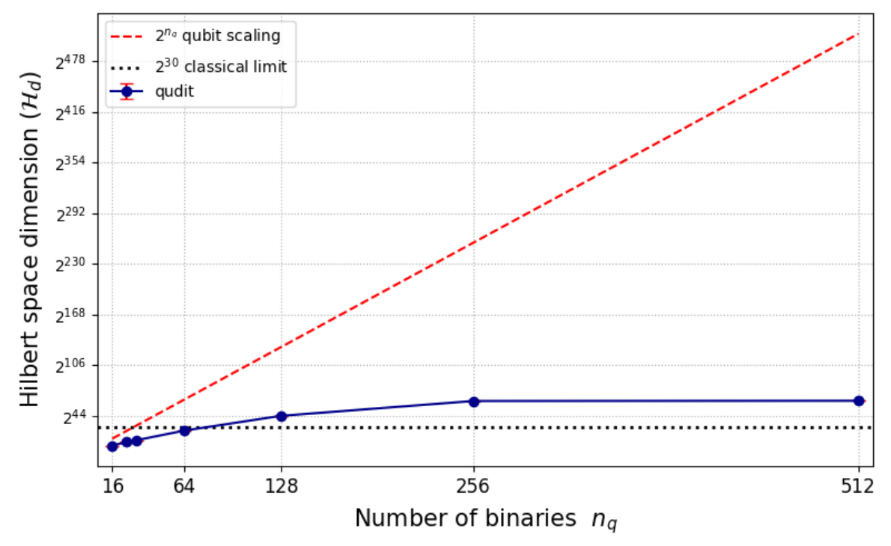

# MP4EO: constraint-aware qudit encoding for satellite mission planning

MP4EO is a Python research framework for combinatorial optimization in Earth observation mission planning, developed during Federico Simpsi’s MSc thesis in collaboration with Thales Alenia Space Italia. Its main scientific contribution is a **constraint-aware qudit encoding**, a compact representation that embeds selected operational constraints directly in its basis. Tensor networks provide an experimental solver backend for the resulting model, independently of the encoding itself.

## Key scientific results

- **Structural reduction of the search space.** The encoding replaces groups of binary variables with qudits whose basis states represent valid local choices, excluding configurations that violate the one-choice constraints. The thesis demonstrates a substantial reduction in the Hilbert-space dimension compared to a standard qubit-based encoding.
- **Validation against a classical reference.** Exact ground-state calculations on the benchmark instances yielded feasible solutions and reproduced Gurobi's optimal objective values to numerical precision.
- **Independent synthetic validation.** The current small example exhaustively checks the C1–C2 basis and C3–C6 projectors against direct classical constraint checks, without a TN solver or industrial data.



*Figure 4.1 from Federico Simpsi’s MSc thesis: Hilbert-space dimension versus number of binary variables, computed on TASI benchmark instances. The logarithmic scale compares direct qubit scaling with the qudit encoding. The dashed line indicates a reference Hilbert-space dimension of $2^{30}$, highlighting the practical memory limitations of explicit state-space representations.*

## Mission-planning problem

For each target, the planner selects a satellite acquisition opportunity and a downlink opportunity. Binary decision variables indicate which opportunities are selected, a weighted mission cost scores the choices. Feasibility requires one acquisition and one downlink per target, consistent satellite assignments, acquisition before download, and adequate preparation time between operations. The full mission model also includes onboard-memory capacity.

The mission-planning objective and the remaining operational constraints are encoded in a diagonal Hamiltonian, whose ground state represents an optimal feasible solution when the penalty weights are appropriately chosen.

$$
H = H_{\text{cost}} + \sum_{k = 3}^6 \lambda_k H_{\text{constraint}, k}
$$

## Encoding: from binary choices to qudit states

A **qudit** is a discrete degree of freedom with more than two possible basis states. Consider an illustrative target with three acquisition opportunities: three binary variables span eight bitstrings, but exactly one acquisition permits only three:

| Acquisition choice | Valid binary configuration | Qudit basis state |
| --- | --- | --- |
| First opportunity | `100` | $\lvert 0\rangle$ |
| Second opportunity | `010` | $\lvert 1\rangle$ |
| Third opportunity | `001` | $\lvert 2\rangle$ |

The qudit basis excludes `000` and configurations with multiple acquisitions. Its label $\lvert 0\rangle$ denotes the first choice, not “no acquisition.” MP4EO applies this single-excitation (one-hot) construction to both acquisition and downlink choices, using two qudits per target. Thus C1–C2 hold by construction.

For $M$ targets, let $a_j$ and $b_j$ count acquisition and downlink opportunities for target $j$. The direct binary model has $N=\sum_{j=1}^{M}(a_j+b_j)$ variables, giving

$$
D_{\mathrm{qubit}}=2^N,
\qquad
D_{\mathrm{qudit}}=\prod_{j=1}^{M}a_j b_j,
\qquad
\frac{D_{\mathrm{qubit}}}{D_{\mathrm{qudit}}}
=\prod_{j=1}^{M}\frac{2^{a_j+b_j}}{a_j b_j}.
$$

Here $D_{\mathrm{qudit}}$ counts states satisfying C1–C2, not the fully feasible mission set. Consistency (C3), temporal ordering (C4), and acquisition/downlink preparation constraints (C5–C6) enter as projector penalties in a diagonal Hamiltonian alongside the objective. The reduction depends on the opportunity counts and does not remove exponential scaling in general. **Onboard memory (C7) is outside the current qudit validation scope.**

## Reproduce the small synthetic check

Using a Python environment with the project's required dependencies installed, run the following command from the repository root

```bash
python -m pytest -q tests/test_qudit_encoding.py
```

The deterministic instance is defined in [tests/test_qudit_encoding.py](tests/test_qudit_encoding.py), independently of industrial datasets. The checks enumerate the encoded basis, verify decoding for C1–C2, and compare C3–C6 projector penalties with classical checks (C4 is compared on C3-feasible states). They require no dataset download, generated data file, or TN run. This reproduces a small encoding check; it does not reproduce the thesis’ Gurobi benchmarks or validate C7.

## Solver scope and limitations

The solver backend files are excluded from this candidate pending verification of copied-code provenance and upstream notices. The included synthetic checks validate the mapper directly. In the thesis, exact ground-state search supported validation on small Hamiltonians but became expensive as the represented space grew. The experimental tensor-network backend uses compressed state representations, including matrix product states (MPS), to explore larger systems. Its performance depends on bond dimension, initialization, penalties, and convergence settings. The thesis reports agreement on smaller cases and inconclusive results on larger ones, including constraint violations. Encoding validation therefore does not establish approximate-solver reliability: decoded feasibility and mission objective must be checked separately, and a favorable penalized cost alone does not establish a valid optimum.

## Confidential data

Confidential TASI datasets, derived datasets, parameter ranges, and industrial adapter defaults are excluded. Figure 4.1 is included as an aggregate result from the thesis; its underlying industrial data are excluded. The synthetic instance is independently specified: it is not sampled from, calibrated against, or derived from industrial data. New instances must likewise be specified independently.

Construct `MP4EOInstance` directly from explicit arrays, as in the synthetic fixture. `from_random_distribution` additionally requires an explicit `parameter_ranges` dictionary containing independently chosen integer bounds; it has no bundled ranges. Industrial CSV adapter entry points raise `NotImplementedError` in this public copy.

## Research & Citation

**Federico Simpsi**, *Tensor Network Approaches to Combinatorial Optimization Problems in Satellite Mission Planning for Earth Observation*. MSc thesis in Physics, Università degli Studi di Padova, academic year 2024–2025.
[Read the full MSc thesis](https://thesis.unipd.it/handle/20.500.12608/95047)

Simpsi’s research contribution centers on the constraint-aware qudit encoding, its implementation, and its validation against classical reference solutions, with TN methods explored as a solver backend. Please cite the thesis when referring to this research.

The original framework implementation is attributed in the source to **Marco Tesoro**. TN components draw on **Quantum TEA**, developed by the **Quantum Padova group**; source acknowledgments also credit the **INFN Baltig Quantum Padova group**. The MSc research involved collaboration with **Thales Alenia Space Italia**.

## Release candidate scope

This is a source checkout for the existing NumPy/SciPy/pytest environment; run the documented command from this directory. No installation, packaging, or new environment is required. Solver backends, legacy code, historical dependency manifests, and industrial data are intentionally absent. The thesis’ Figure 4.1 is included with its original attribution. Original source attributions and the existing LICENSE are preserved; see [NOTICE](NOTICE) for provenance and remaining attribution questions.
